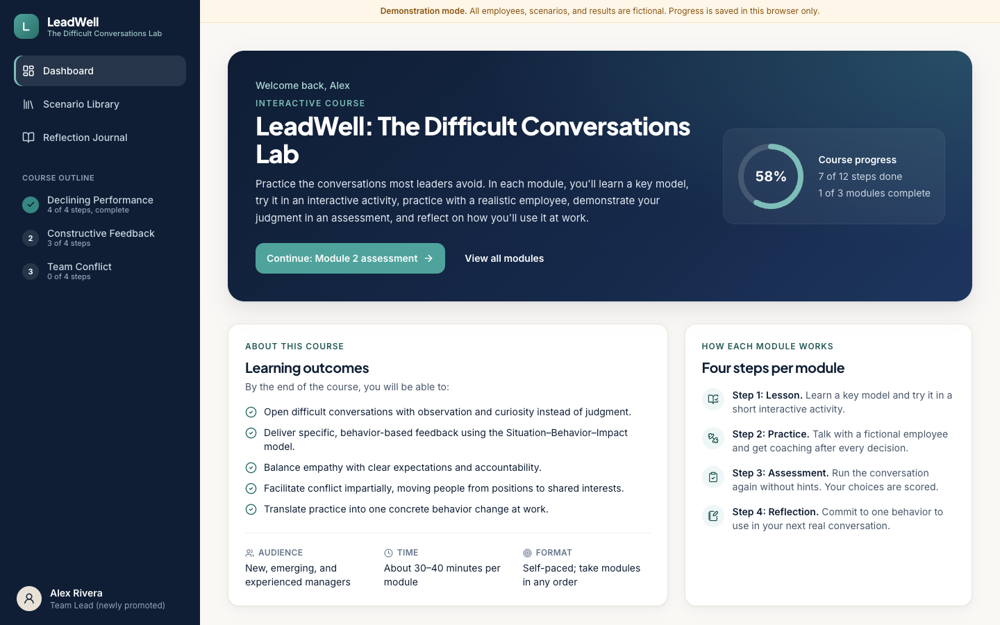
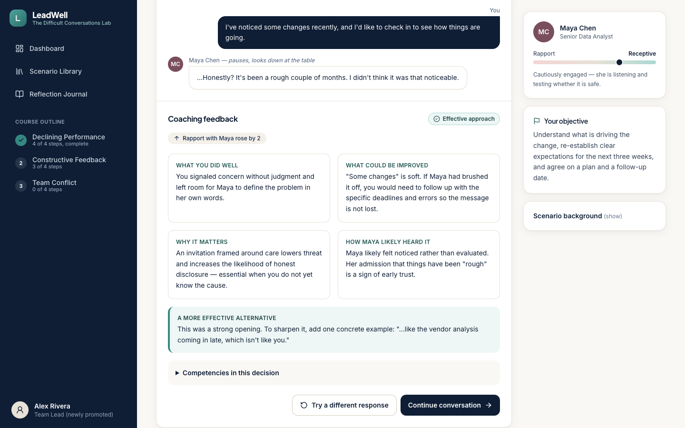
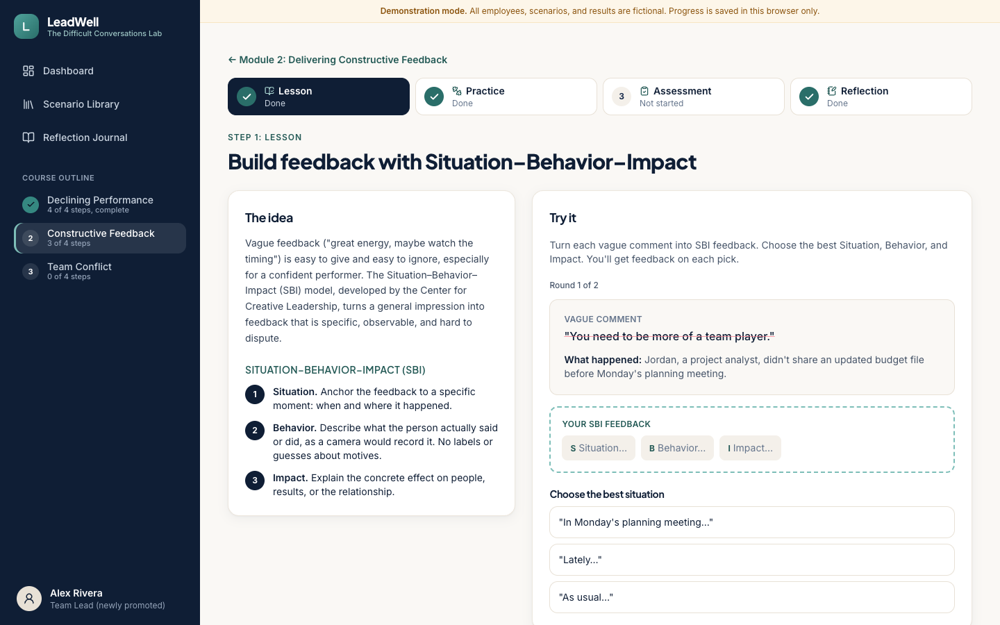
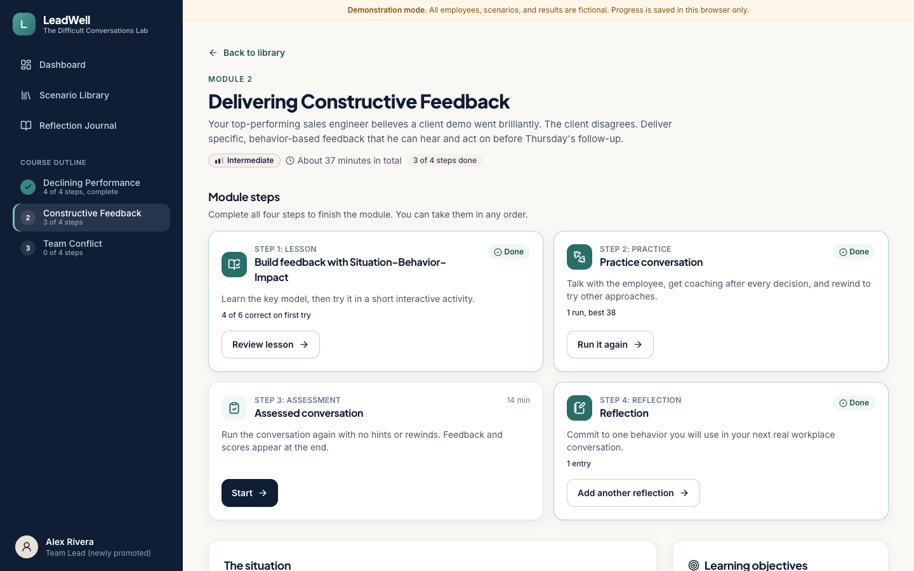
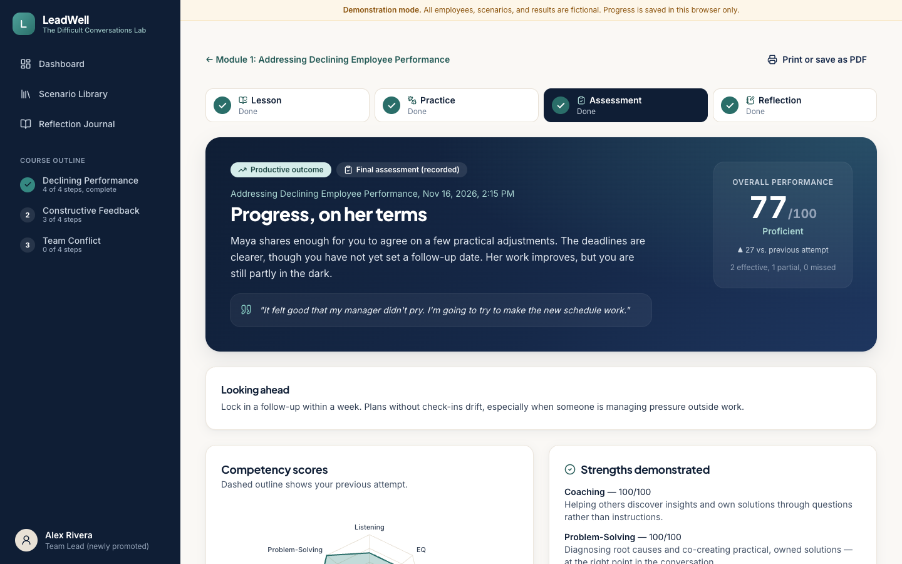

# LeadWell: The Difficult Conversations Lab

An interactive, self-paced leadership course for practicing the conversations most managers avoid. Each module pairs a short lesson and hands-on activity with a branching conversation simulation: learners talk with a realistic, fictional employee, see how each choice changes the employee's response and the rapport between them, get coaching after every decision, and finish with a competency-based results report and a reflection commitment.

**[Try the live demo](https://claude.ai/artifact/GEezhnKdP8y5gvVRwSAWQ1)**. No sign-up needed. Progress is saved in your browser only. On the dashboard, choose **Load sample progress** to explore a course that is partly done.

> All people, organizations, scenarios, learners, and results in this demonstration are fictional.



## Highlights

- **Course structure:** 3 modules, each with four tracked steps: Lesson → Practice → Assessment → Reflection.
- **Interactive lessons:** a different activity type per module.
  - Sorting conversation openers.
  - Building Situation–Behavior–Impact feedback from parts.
  - Matching positions to underlying interests.
- **Branching simulations:** each path has at least 3 decision points, and every choice moves a live rapport meter.
- **Five-part coaching** after every practice decision: what you did well, what to improve, why it matters, how the employee likely heard it, and a more effective alternative.
- **Competency scoring** across eight leadership competencies, with proficiency bands always shown as text.
- **Transfer to work:** each module ends with a workplace commitment saved to a reflection journal and collected in a course summary.
- **Content as data:** scenarios, personas, and lessons are JSON, checked by automated validation tests.

| Coaching feedback after a practice decision | Interactive lesson: build SBI feedback |
|---|---|
|  |  |
| **Module overview with step progress** | **Assessment results** |
|  |  |

## Built with

React 18, TypeScript, Vite, Tailwind CSS, Recharts, Lucide icons, Vitest. There's also an optional Supabase adapter for saving progress to a database.

## Quick start

```bash
npm install
npm run dev        # http://localhost:5173
npm test           # engine + content validation tests
npm run build      # production build in dist/
```

The build is a static site with hash routing and relative asset paths, so `dist/` can be deployed as-is to Netlify, Vercel, GitHub Pages, S3, or any static host.

### Sandboxed single-file build (Claude artifact)

```bash
npm run build:artifact && python3 scripts/make-artifact.py   # → dist-artifact/leadwell.html
```

This variant (`VITE_TARGET=artifact`) inlines all CSS and JS into one ASCII-only page, keeps routes in memory instead of the URL hash, and hides the Print button. The live demo above uses this build.

## What's included

LeadWell is presented as a self-paced interactive course. Each available scenario is a module with four steps: **Lesson → Practice → Assessment → Reflection**. All steps are open, each is tracked with a checkmark, and a module is complete when all four are done. Learners can take modules in any order.

| Area | Route | Notes |
|---|---|---|
| Dashboard (course home) | `/` | Course title, learning outcomes, how modules work, syllabus with step progress, competency overview, weekly practice tip, recent activity, continue button, reset progress |
| Scenario Library | `/library` | Searchable, filterable module list; 3 modules available, 3 coming soon |
| Module | `/modules/:id` | The four steps with status, situation, manager objective, learning objectives |
| Lesson | `/modules/:id/lesson` | Key model plus an interactive activity: sort statements (Module 1), build SBI feedback from parts (Module 2), match positions to interests (Module 3) |
| Practice / Assessment | `/simulate/:id?mode=` | Branching conversation; practice has coaching and rewinds, assessment holds feedback until the end |
| Results | `/results/:attemptId` | Outcome, scores, competency breakdown, decision review, resources, next step in the module |
| Reflection | `/modules/:id/reflect` | Workplace commitment saved to the journal |
| Reflection Journal | `/journal` | Private entries: create, edit, delete |
| Course summary | `/course-summary` | Unlocks when all modules are complete: module results, competencies, commitments |

## Instructional design

- **Practice vs. formative vs. summative.** Practice mode gives coaching after every decision and lets the learner rewind. Assessment mode holds all feedback until the end and records a score. The competency profile uses assessment evidence and labels practice-only scores as estimates.
- **Nuanced options.** Each decision point offers an *effective*, a *partially effective*, and a *missed-opportunity* response. Partial options are reasonable instincts, such as directness without curiosity or empathy without accountability.
- **Five-part coaching** for every option: what you did well, what to improve, why it matters, how the employee likely heard it, and a more effective alternative.
- **Lesson before simulation.** Each module starts with a short concept lesson and an interactive activity, so learners try the model before using it in a conversation. Lessons record how many answers were right on the first try.
- **Transfer.** Each module ends with a commitment to one observable behavior. Commitments are saved to the journal and collected on the course summary.
- **Reinforcement.** The dashboard shows a weekly practice tip for the learner's weakest competency.

### Scoring

Each option rates 0–3 on the competencies that decision assesses. A competency score is the points earned divided by the points available, across every decision that assessed it. The overall score is the average of the decision scores. The proficiency bands are Advanced (85+), Proficient (70+), Developing (50+), and Emerging (below 50), and the band is always shown as text. Rapport is tracked separately: `trust = authored delta + persona.approachResponses[approach].trustModifier`. That means the same approach can help with one employee and hurt with another.

## Architecture

```
src/
  types.ts                     domain model (Scenario, DecisionNode, Persona, Attempt, Reflection…)
  data/
    scenarios/*.json           JSON-driven scenario content
    personas.json              employee personality profiles (+ aiProfile for future AI use)
    competencies.ts            definitions, indicators, refreshers, resources
    lessons.json               lesson concepts and interactive activities per module
    sampleHistory.ts           optional fictional learner history
  engine/
    simulation.ts              pure branching state machine (choose, rewind, rapport)
    scoring.ts                 path scoring + competency profile
    responseEngine.ts          ResponseEngine interface; ScriptedResponseEngine today
    validation.ts              graph + content validator (used by tests)
    course.ts                  module steps, course progress, next step
    recommend.ts               recommendations, spaced review, session autosave
  services/
    repository.ts              LearnerRepository interface + LocalDemoRepository
    supabaseRepository.ts      Supabase implementation of the same interface
  state/AppContext.tsx         app state, persistence, toasts
  pages/, components/          UI
supabase/schema.sql            tables, views, and Row Level Security policies
scripts/make-artifact.py       packs the artifact build into a single HTML file
docs/screenshots/              images used in this README
```

### Adding a scenario

1. Copy an existing file in `src/data/scenarios/`, and add a matching lesson to `src/data/lessons.json`.
2. Write the nodes, options (with `ratings`, `trust`, `reaction`, and `feedback`), and outcomes. Terminal options set `"next": null` and an `"outcome"`.
3. Register the file in `src/data/index.ts`.
4. Run `npm test`. The validator checks for broken links, cycles, unreachable nodes, paths with fewer than 3 decisions, missing feedback fields, and invalid ratings.

### Adding AI conversation later

The simulator gets employee replies from `responseEngine.respond(ctx)`. To use an AI model, write an `AIResponseEngine` that implements `ResponseEngine`. It can use `buildAIPersonaPrompt()`, which already includes each persona's voice, hidden context, and boundaries. Scoring, feedback, persistence, and the UI do not change.

### Supabase

Demo mode needs no backend and stores progress in the browser's `localStorage`. To use Supabase:

1. Run `supabase/schema.sql` in your project.
2. Copy `.env.example` to `.env` and set `VITE_SUPABASE_URL` and `VITE_SUPABASE_ANON_KEY`.
3. After sign-in, pass `new SupabaseRepository(getSupabaseClient()!, user.id)` to `<AppProvider repository={…}>`.

The Row Level Security policies limit each learner to their own attempts, lesson results, and reflections. The schema also includes optional administrator policies for reporting on attempts and scores. No policy gives administrators access to reflection text; they only get the `admin_reflection_counts` view. The demo has no admin interface.

## Accessibility

The app aims for WCAG 2.2 AA:

- skip link, landmarks, and a logical heading order
- visible focus rings and full keyboard operation
- labeled form fields with inline, announced error messages
- `aria-live` announcements for employee replies and confirmations
- text descriptions for charts
- touch targets of at least 44 px
- support for `prefers-reduced-motion`
- quality and proficiency always shown with text or icons, never color alone
